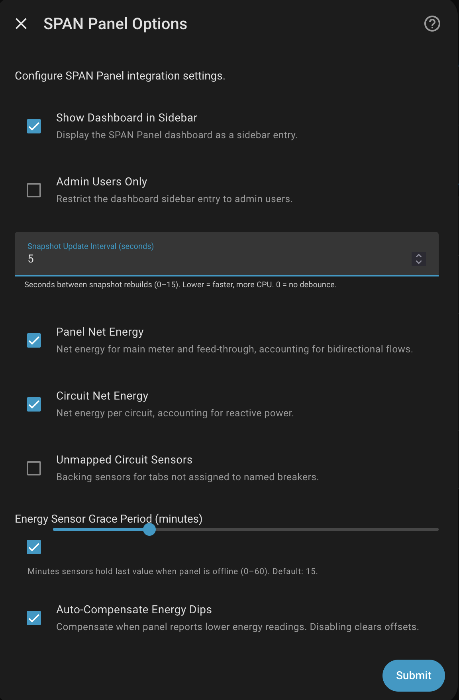
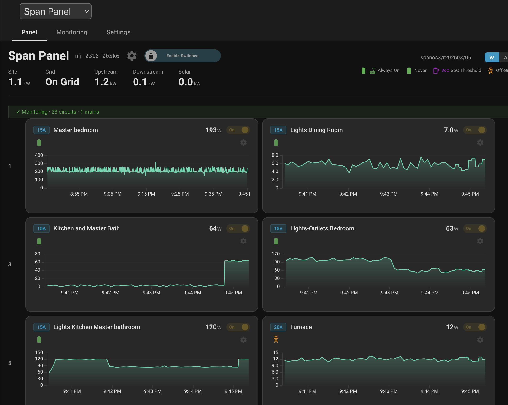
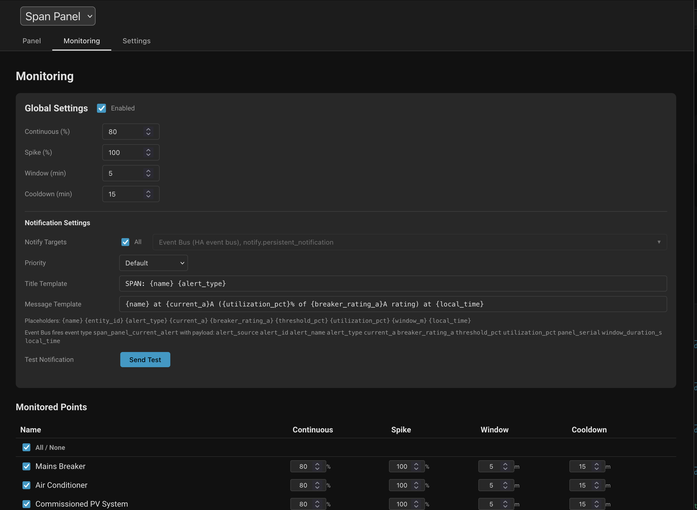

# Frontend Dashboard

The SPAN Panel integration includes a built-in frontend dashboard accessible from the Home Assistant sidebar. The dashboard provides real-time visualization of
your panel's electrical activity, circuit-level monitoring configuration, and integration settings — all without requiring a separate Lovelace card.

## Enabling the Dashboard

The dashboard is enabled via the integration's configuration options:

1. Go to `Settings` > `Devices & Services` > `SPAN Panel` > `Configure` > `General Options`
2. Check **Show Dashboard in Sidebar** to add a sidebar entry
3. Optionally check **Admin Users Only** to restrict access to administrator accounts

## Panel View

The Panel tab displays your SPAN panel layout with real-time circuit-level power graphs. Each circuit card shows:

- **Breaker rating** and **current power draw** in the card header
- **Circuit priority icons** indicating always-on, never-shed, SoC threshold, or off-grid shed behavior
- **Historical power or current graph** with configurable time horizon globally or per circuit
- **Switch control** for user-controllable circuits (via the safety slider in the card header)

The top banner summarizes panel-level metrics: site power, grid state, upstream/downstream current, and solar production. A firmware version badge and legend
for circuit priority icons are displayed alongside.

Use the **Enable Switches** toggle in the banner to globally enable or disable circuit switch controls.

## List Views — By Activity and By Area

Beyond the panel grid, each panel (and the cross-panel Favorites view) exposes two list-oriented tabs:

- **By Activity** — circuits sorted by live power (or current, when the unit toggle is on Amps), highest first. A search box filters rows by name.
- **By Area** — circuits grouped by their Home Assistant area (entity-level assignment first, then device-level fallback). Unassigned circuits land in a
  dedicated group at the bottom.

Each row shows breaker rating, live utilization %, circuit name, shedding-priority icon, an ON/OFF toggle (tappable once the **Enable Switches** slider is
armed), live power / current value, a gear icon that opens the side panel, and a chevron to expand the row's chart.

### List view columns

By default the list views stack circuits one per row. You can switch to a **2** or **3** column grid from the **Graph Settings** side panel (gear icon at the
top of the panel header) → **List View Columns**.

- Rows flow left-to-right, top-to-bottom, so the existing sort order (value-desc for By Activity, alphabetical-within-area for By Area) becomes top-left through
  bottom-right.
- Expanding a row shows its chart directly below, constrained to the same column as the row.
- Viewports narrower than 600 px force single-column regardless of the setting.
- The choice is stored per browser in `localStorage`, so you can keep a phone in single-column and a desktop in three columns.

## Monitoring View

The Monitoring tab provides current-based alerting for individual circuits. It detects sustained high utilization and transient spikes relative to each
circuit's breaker rating, then delivers notifications through configurable channels. Where a circuit on a MAIN 32 has a monitoring rating, set in its Monitoring
section, thresholds and utilization use the monitoring rating instead of the panel's breaker rating.

### Global Settings

- **Continuous (%)** — Sustained utilization threshold as a percentage of breaker rating. When a circuit draws more than this percentage continuously for the
  configured window duration, an alert is triggered. For example, a 15A breaker at 80% fires when the circuit sustains above 12A.
- **Spike (%)** — Instantaneous spike threshold as a percentage of breaker rating. A single reading above this level triggers an immediate alert without waiting
  for the window duration. For example, a 15A breaker at 100% fires the moment current exceeds 15A.
- **Window (min)** — How long a circuit must continuously exceed the continuous threshold before an alert fires. Short windows (e.g., 1–2 min) catch brief
  overloads; longer windows (e.g., 5–15 min) filter out transient loads like motor startup surges.
- **Cooldown (min)** — Minimum quiet period after an alert before the same circuit can trigger another alert. Prevents notification floods when a circuit
  oscillates around the threshold. For example, a 15-minute cooldown means you receive at most one alert per circuit every 15 minutes.

### Notification Settings

- **All Targets** — Select all notification targets at once
- **Notify Targets** — Individual notification targets including mobile devices, persistent notification, and the HA event bus
- **Priority** — Notification priority level (controls iOS interruption level and Android notification channel)
- **Title/Message Templates** — Customizable templates with the following variables:

  | Variable             | Description                                  | Example                     |
  | -------------------- | -------------------------------------------- | --------------------------- |
  | `{name}`             | Circuit or mains friendly name               | Kitchen Oven                |
  | `{entity_id}`        | HA entity ID                                 | sensor.kitchen_oven_current |
  | `{alert_type}`       | Alert category                               | spike, continuous_overload  |
  | `{current_a}`        | Current draw in amps                         | 18.3                        |
  | `{breaker_rating_a}` | Rating in amps the circuit is judged against | 20                          |
  | `{threshold_pct}`    | Configured threshold percentage              | 80                          |
  | `{utilization_pct}`  | Actual utilization percentage                | 91.5                        |
  | `{window_m}`         | Window duration in minutes                   | 5                           |
  | `{local_time}`       | Local time of the alert                      | 2:15 PM                     |

  `{breaker_rating_a}` keeps its name so existing templates still work, but it carries the rating the circuit is judged against: the circuit's monitoring rating
  where one is set, else the breaker rating the panel publishes.

- **Event bus** — With the HA event bus selected, each alert fires a `span_panel_current_alert` event for automations. Its data:

  | Key                          | Description                                                                                                    |
  | ---------------------------- | -------------------------------------------------------------------------------------------------------------- |
  | `alert_source`               | `circuit` or `mains`                                                                                           |
  | `alert_id`                   | The circuit's id, or the mains leg (such as `upstream_l1`)                                                     |
  | `alert_name`                 | Circuit or mains friendly name                                                                                 |
  | `alert_type`                 | `spike` or `continuous_overload`                                                                               |
  | `current_a`                  | Current draw in amps                                                                                           |
  | `breaker_rating_a`           | The breaker rating the panel publishes; for circuits that share a meter, their sum, and null if any has none   |
  | `monitoring_rating_a`        | The rating the alert judged against: the circuit's monitoring rating where one is set, else the panel's rating |
  | `monitoring_rating_user_set` | Whether `monitoring_rating_a` is a monitoring rating you set                                                   |
  | `threshold_pct`              | Configured threshold percentage                                                                                |
  | `utilization_pct`            | Actual utilization percentage, against `monitoring_rating_a`                                                   |
  | `panel_serial`               | The panel's serial number                                                                                      |
  | `local_time`                 | Local time of the alert                                                                                        |
  | `window_duration_s`          | Seconds spent over the continuous threshold (continuous overloads; the test event carries a sample)            |
  | `over_threshold_since`       | When the circuit went over the continuous threshold, as an ISO 8601 time (continuous overloads only)           |
  | `test`                       | Present, and true, only on the event the test notification fires                                               |

  A monitoring rating never changes `breaker_rating_a`, which is the panel's rating, as the Breaker Rating sensor shows. The rating the `{breaker_rating_a}`
  text placeholder carries is `monitoring_rating_a` here. For the mains both are its rating, and `monitoring_rating_user_set` is false.

### Monitored Points

Each circuit can be individually enabled or disabled for monitoring, with per-circuit overrides for continuous threshold, spike threshold, window, and cooldown
values.

### Setting a Monitoring Rating

Current monitoring divides a circuit's current by its breaker rating. A MAIN 32 publishes a tandem breaker, which puts two breakers in one space, as one circuit
with one current reading and the rating of one half, so the same current looks like an overload. A monitoring rating tells current monitoring what to judge the
circuit against instead.

On panels other than MAIN 32 a monitoring rating is not offered: the Monitoring section shows no field for it and the services refuse one. Those panels publish
each circuit of a multi-load breaker as its own circuit, with its own rating, and name the circuits that share its meter, so current monitoring already judges
them together (see [Circuits That Share a Meter or Relay](README.md#circuits-that-share-a-meter-or-relay)).

Set it in the circuit's side panel, opened from its gear icon, in the **Monitoring** section while monitoring is on for that circuit, or with the
`span_panel.set_circuit_monitoring_rating` and `span_panel.clear_circuit_monitoring_rating` services. It is a whole number of amps, from 1 up to the panel's
service rating, and only a circuit the panel publishes a breaker rating for can be given one. Enter the most current the measured wire can carry; for a tandem
in one space, that is the sum of its breakers.

Entering the panel's own rating clears the monitoring rating, as does the reset beside it, and the circuit is judged against the panel's rating again. Turning
monitoring off keeps the monitoring rating, and it applies again when monitoring is turned back on. Resetting thresholds leaves it alone.

Current monitoring then judges the circuit against the monitoring rating, so its thresholds, utilization and alert text all use it, and the Monitoring views
show it as "set by you" with the panel's rating beside it. The `{breaker_rating_a}` alert placeholder keeps its name and carries that rating. Nothing else
changes: the Breaker Rating sensor, the panel view's breaker labels and every `breaker_rating_a` the integration reports always show the panel's rating, and
energy counter checks keep using it. The panel topology, the monitoring status and the `span_panel_current_alert` event add `monitoring_rating_a`, the rating
judged against, and `monitoring_rating_user_set` beside it.

For a circuit that spans more than one space, such as a 240 V breaker sharing a leg with a 120 V one, the right value depends on which leg the panel measures,
and the panel does not publish that. The dashboard says so. A value set too high hides a real overload, so turning monitoring off for that circuit is the safer
choice than guessing.

A notification tells you when the panel overtakes a monitoring rating:

- the panel's rating for the circuit changed, and the monitoring rating still applies;
- the panel's rating now matches the monitoring rating, which was removed;
- the panel no longer reports a rating for the circuit, and the monitoring rating was removed;
- the circuit is no longer on the panel, and the monitoring rating was removed;
- the panel's service rating dropped below the monitoring rating, or the panel no longer publishes one, and the monitoring rating was removed;
- the panel now publishes each circuit of a multi-load breaker with its own rating, and the monitoring rating was removed.

Each line names the circuit, your monitoring rating, and the panel's rating before and, where it still reports one, after. A rating that changed and changed
back before you looked is not reported.

## Adopted View

The Adopted tab is where you tell the integration what an adopted entity means. Your panel's schema is vendor-extensible, so it can publish devices and readings
this integration has never modeled; those arrive carrying only what the wire says about them, and the rest is yours to assert. The tab is shown to administrator
accounts only, and on a panel rather than in the Favorites view.

Rows are grouped by the device card they render on — one group per adopted device, one per modeled device carrying vendor readings — and each row expands into a
small form. A badge marks a row you have already curated, and another marks one whose saved values the panel has stopped supporting.

Three of the fields are the integration's own, because Home Assistant has nowhere to keep them for an entity built from a vendor declaration:

- **Device class** — what kind of quantity the reading is, which gives it a sensible icon and, for the classes Home Assistant knows how to convert, a choice of
  display unit.
- **Statistics class** — Home Assistant's `state_class`, which is what enrolls the reading in long-term statistics and makes it usable on an Energy dashboard.
- **Prominence** — whether the entity stays filed under Diagnostics or is promoted out of it.

The rest of the form — **name**, **display unit** and **precision**, and whether the entity is **enabled** — is Home Assistant's own entity settings, shown here
so you do not have to go elsewhere, and written straight into Home Assistant's registry exactly as if you had edited the entity there. Those fields appear once
the entity exists in the registry; until then the row offers the integration's three and says so. The icon and the area are Home Assistant's own settings too
and are not restated here — set them from the entity's settings dialog.

You are offered only what your panel's declaration allows: a statistics class on numeric readings, and the device classes that fit both the declared datatype
and the unit the panel publishes, so a text reading is never offered a class that expects a number. Setting or clearing a statistics class asks you to confirm
first, because that choice is written into recorded history and correcting the class afterwards does not repair what was already recorded. Saving reloads the
integration, which is how the setting takes effect — the reload rebuilds the entity already carrying what you asserted.

See [The Adopted Tab](README.md#the-adopted-tab) in the README for the fuller account of what gets adopted and why.

## Favorites View

The dashboard supports a cross-panel **Favorites** view that lets you curate a single workspace from circuits and sub-devices (BESS, EVSE) belonging to any of
your configured SPAN panels. This is useful when you want a single place to keep an eye on a small set of important loads — say, the EV charger on Panel A and
the heat pump on Panel B — without switching panels in the dropdown.

### Marking favorites

Favorites are marked from the **side panels** that open via the gear icons in the dashboard. The standalone span-card (used in Lovelace dashboards) does not
expose hearts because it has no Favorites view.

There are three places to toggle a favorite:

- **Panel-level "Graph Settings" side panel** — opened from the gear icon at the top of the panel header. The per-circuit and per-sub-device lists each render a
  heart icon next to the time-horizon dropdown. Click the heart to favorite or un-favorite that target without leaving the list.
- **Per-circuit side panel** — opened from a circuit's gear icon in the breaker grid (or in the By Activity / By Area rows). A "Favorite" section with a switch
  sits between the relay control and the shedding priority.
- **Per-sub-device side panel** — opened from the gear icon on a BESS or EVSE tile. Same Favorite section as the per-circuit panel.

A circuit or sub-device can be favorited on any panel. The integration stores the favorites under the configured SPAN integration's storage, so they sync across
browsers and devices.

### The Favorites entry

When you have at least one favorite configured, a synthetic **Favorites** entry appears at the top of the panel dropdown. Switching to it loads the aggregated
view. Removing the last favorite while the Favorites view is active automatically switches the dropdown and view back to the first real panel.

### Tabs in the Favorites view

The Favorites view exposes **By Activity**, **By Area**, and **Monitoring** tabs. **By Panel** is not available because the physical breaker grid is inherently
single-panel.

- **By Activity / By Area** — Show the favorited circuits sorted by power (or grouped by area). Sub-device tiles render above the circuit list. When more than
  one panel contributes favorites, circuit and sub-device names are prefixed with their panel name so you can tell them apart.
- **Monitoring** — Stacks one Monitoring block per contributing panel, since threshold and notification settings are per-panel.

The Favorites view is **stateful**: the active tab, expanded rows, and search query are remembered in the browser and restored when you come back to it.

### Editing from the Favorites view

Opening a circuit's or sub-device's gear from the Favorites view targets the originating panel for any side-panel edits (graph horizon, monitoring thresholds,
relay state, etc.). Settings always go to the right panel even though the targets are aggregated in the Favorites view.

### Services

The favorites map is also exposed as services for automations and scripts:

- `span_panel.get_favorites` — Returns the current map.
- `span_panel.add_favorite` / `span_panel.remove_favorite` — Take a single `entity_id` (any sensor on the circuit or sub-device — current, power, SoC, etc.).
  The integration resolves the entity to its panel and target, so you never need to know internal circuit UUIDs or HA device IDs.
